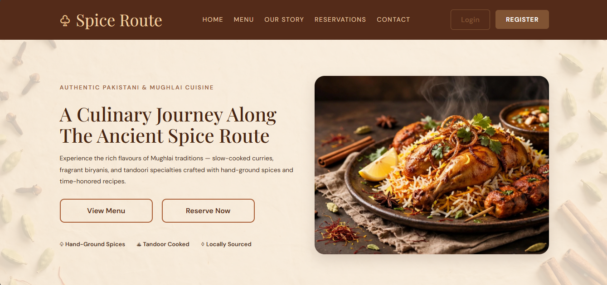
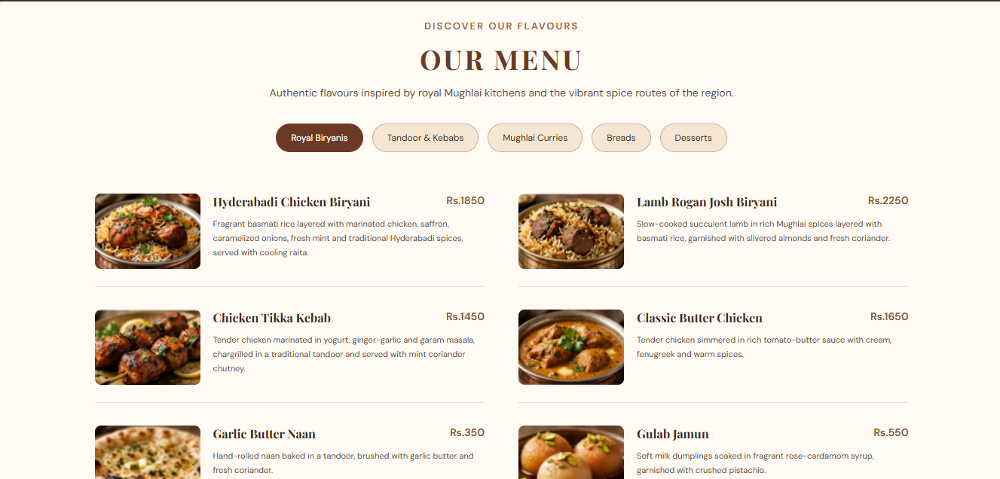
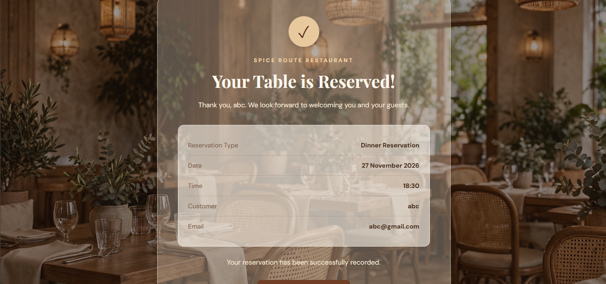
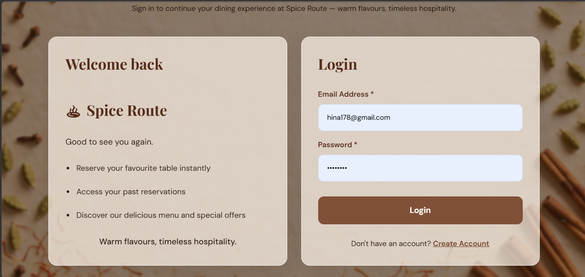
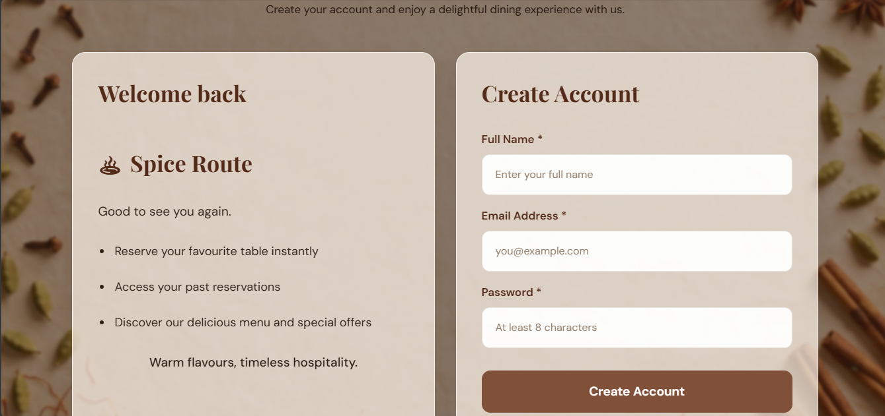
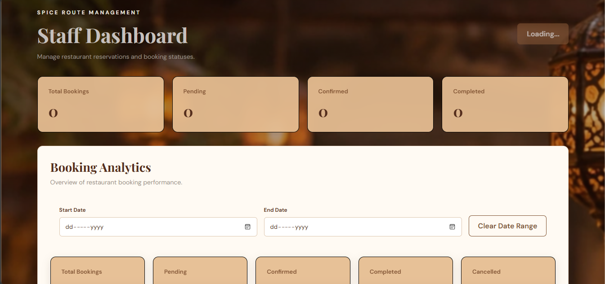

# Spice Route Restaurant Booking Platform

A full-stack restaurant booking platform developed for Spice Route Restaurant. It provides customers with an easy way to explore the restaurant, check reservation availability, make bookings, and receive booking confirmations.

Restaurant staff can log in to a protected dashboard to manage reservations, update booking statuses, search and filter bookings, and review booking analytics.

**Live Website:** https://spice-route-booking-sdfp.vercel.app/

**Backend API:** https://spice-route-booking.vercel.app/

**GitHub Repository:** https://github.com/Hina1munir2/Spice-Route-Booking

The live website link above is the public production deployment.

---

## 1. Project Features

### Customer Features

- Browse the restaurant homepage, menu, about, and contact pages.
- View available restaurant services.
- Select a reservation date.
- Check available time slots provided by the backend.
- Choose an available time slot and enter customer details.
- Submit a restaurant booking.
- View a booking confirmation after successful submission.
- Register, log in, and log out using a customer account.

### Staff Features

- Log in using a staff account.
- Access a protected staff dashboard.
- View restaurant bookings and booking summary counts.
- Search bookings by customer or service details.
- Filter bookings by date and booking status.
- Update booking statuses.
- View booking analytics, including:
  - Total bookings.
  - Booking status counts.
  - Daily and monthly booking trends.
  - Popular restaurant services.
  - Analytics filtered by date range.

Staff-only features are protected using JWT authentication and role-based authorization. Public registration creates customer accounts only.

### Email Booking Reminders

The application includes an email reminder service using Nodemailer and Gmail SMTP.

- The local development scheduler checks for reminders every 15 minutes.
- The deployed Vercel Cron endpoint is configured to run daily.
- Reminder status and sent time are stored with each booking.

**Production limitation:** Vercel Hobby cron is limited to once per day and can have timing variations. Therefore, deployed reminders are not guaranteed to arrive exactly 24 hours before a reservation. More frequent and reliable scheduling is a future improvement.

---

## 2. Technology Stack

| Area | Technologies |
|---|---|
| Frontend | React, Vite, React Router, Axios, CSS |
| Backend | Node.js, Express.js |
| Database | MongoDB Atlas, Mongoose |
| Authentication | JWT, bcryptjs |
| Email Reminders | Nodemailer, Gmail SMTP, node-cron, Luxon |
| Testing | Jest, Supertest |
| Deployment | Vercel |

---

## 3. Live Deployment Architecture

The frontend and backend are deployed as two separate Vercel projects from the same GitHub repository.

| Component | Deployment |
|---|---|
| Frontend | https://spice-route-booking-sdfp.vercel.app/ |
| Backend | https://spice-route-booking.vercel.app/ |
| Database | MongoDB Atlas |

The frontend communicates with the backend through the `VITE_API_URL` environment variable.

The backend uses the `CLIENT_URL` environment variable to allow requests from the frontend origin. These URLs must match the deployed frontend and backend configuration.

Environment variables and application secrets are configured through Vercel project settings rather than committed to the repository.

---

## 4. Run the Project Locally

### Prerequisites

Before running the project, install or prepare:

- Node.js and npm.
- A MongoDB Atlas database or local MongoDB instance.
- Gmail SMTP credentials and a Gmail App Password if you want to test email reminders.

### Step 1: Clone the Repository

```bash
git clone https://github.com/Hina1munir2/Spice-Route-Booking.git
cd Spice-Route-Booking
```

### Step 2: Configure the Backend

Open the `server` folder and create a `.env` file.

Add your own configuration values:

```env
PORT=5000
MONGODB_URI=your_mongodb_connection_string
JWT_SECRET=your_long_random_secret
JWT_EXPIRES_IN=7d
CLIENT_URL=http://localhost:5173

GMAIL_USER=your_gmail_address
GMAIL_APP_PASSWORD=your_gmail_app_password
RESTAURANT_NAME=Spice Route Restaurant
RESTAURANT_TIMEZONE=Asia/Karachi
```

Install backend dependencies:

```powershell
cd server
npm install
```

Start the backend development server:

```powershell
npm run dev
```

The backend API runs at:

`http://localhost:5000`

The root endpoint (`GET /`) reports API status and database connection status.

### Step 3: Create a Staff Account

Use the staff account setup script to create a staff account.

Configure the staff details required by the script in `server/.env`, then run:

```powershell
npm run create:staff
```

Public customer registration cannot be used to create staff accounts.

### Step 4: Configure the Frontend

Open another terminal from the project root.

Create a `.env` file inside the `client` folder:

```env
VITE_API_URL=http://localhost:5000
```

Install frontend dependencies:

```powershell
cd client
npm install
```

Start the frontend:

```powershell
npm run dev
```

Vite normally runs the frontend at:

`http://localhost:5173`

Keep both the frontend and backend development servers running while using the application.

### Environment Variable Notes

- `MONGODB_URI` contains the MongoDB connection string.
- `JWT_SECRET` is used to sign authentication tokens.
- `GMAIL_USER` and `GMAIL_APP_PASSWORD` are used for email reminders.
- `CLIENT_URL` specifies the frontend origin allowed by backend CORS.
- `VITE_API_URL` specifies the backend URL used by the frontend.
- `CRON_SECRET` protects the deployed reminder endpoint.

Never commit secrets or `.env` files to GitHub. Configure production environment variables through the relevant Vercel project settings.

Remember that `VITE_` variables are exposed to the browser and must not contain private credentials.

---

## 5. Main API Endpoints

| Method | Endpoint | Purpose |
|---|---|---|
| GET | `/` | Check API and database status |
| GET | `/services` | Get available restaurant services |
| GET | `/services/:serviceId/availability?date=YYYY-MM-DD` | Check available slots for a service and date |
| POST | `/bookings` | Create a restaurant booking |
| POST | `/auth/register` | Register a customer |
| POST | `/auth/login` | Log in a customer or staff member |
| GET | `/auth/me` | Get the authenticated user's profile |
| GET | `/staff/bookings` | Get bookings (staff only) |
| PATCH | `/staff/bookings/:bookingId/status` | Update booking status (staff only) |
| GET | `/staff/analytics` | Get booking analytics (staff only) |
| GET | `/staff/analytics?startDate=YYYY-MM-DD&endDate=YYYY-MM-DD` | Get analytics for a date range (staff only) |
| GET | `/api/cron/reminders` | Trigger a reminder check (requires cron bearer secret) |

Protected endpoints require a JWT in the following request header:

```text
Authorization: Bearer <token>
```

The reminder cron endpoint requires its separate `CRON_SECRET` bearer token.

---

## 6. Testing and Verification

Backend automated tests can be run from the `server` directory:

```powershell
npm test -- --runInBand
```

**Latest recorded backend test results:**

- 5 test suites passed.
- 44 tests passed.

The automated tests cover:

- Booking API functionality.
- Authentication and role-based authorization.
- Staff booking management.
- Email reminder processing.
- Booking analytics and date-range validation.

The frontend production build was also completed successfully.

### Manual Verification

The deployed application was manually checked:

- The backend root endpoint responded successfully and reported MongoDB as connected.
- The services endpoint returned the configured Dinner Reservation service and available slots.
- The live customer booking flow completed successfully and displayed a confirmation.
- Customer registration and login were tested.
- Staff login and dashboard access were tested.
- Booking analytics were tested.

These checks are functional verification. No load or performance benchmark is claimed.

---

## 7. Key Decisions, Trade-offs, and Verification

### Separate Frontend and Backend Deployments

**Decision:** Deploy the React/Vite frontend and Express API as separate Vercel projects from the same repository.

**Reason:** Each part can be configured and redeployed independently.

**Trade-off:** The frontend API URL and backend CORS origin must remain correctly configured.

**Verification:** The production frontend successfully communicated with the deployed backend, retrieved services, and completed a customer booking.

### Backend-Controlled Availability

**Decision:** Retrieve available booking slots from the backend for the selected service and date instead of hardcoding availability in React.

**Reason:** The backend remains the source of truth and can account for existing reservations when processing a booking.

**Trade-off:** Changing the selected service or date requires an API request and depends on backend availability.

**Verification:** The services endpoint returned the configured service and slots, and the live booking flow completed successfully.

### JWT Authentication and Role-Based Access

**Decision:** Use JWT authentication with separate customer and staff roles. Public registration creates customer accounts only.

**Reason:** Staff booking management and analytics must not be accessible to ordinary customers.

**Trade-off:** The frontend must manage authentication tokens and include them in protected requests. Browser session storage is accessible to JavaScript, so an XSS vulnerability could expose a token. A more hardened production design could use secure HttpOnly cookies with appropriate CSRF protections.

**Verification:** Automated tests cover successful and failed authentication and role restrictions. Staff login and dashboard access were also checked on the deployed website.

### Preserve Cancelled Bookings

**Decision:** Update a booking's status to `cancelled` instead of deleting its database record.

**Reason:** Keeping cancelled bookings preserves reservation history for restaurant staff.

**Trade-off:** Cancelled records remain in the database, so staff need filters to focus on active bookings.

**Verification:** Booking management tests cover status updates and filtering.

### Reminder State Stored with Each Booking

**Decision:** Store `reminderSent` and `reminderSentAt` fields on the booking document.

**Reason:** The current workflow sends one reminder per booking, so a separate reminder collection is not necessary.

**Trade-off:** This provides limited reminder history. The in-process overlap guard also does not coordinate multiple server instances. A durable queue or transactional outbox would be more reliable for a larger deployment.

**Verification:** Reminder tests cover due and not-yet-due bookings, already-sent reminders, email failures, and database errors.

### Serverless Deployment and Scheduled Reminders

**Decision:** Cache MongoDB connections for serverless requests and expose a bearer-protected reminder endpoint for Vercel Cron.

**Reason:** A serverless deployment cannot rely on a continuously running in-process cron scheduler.

**Trade-off:** The local scheduler runs every 15 minutes, while the deployed Hobby cron is configured for a daily run and can have timing variations. Exact 24-hour reminder delivery is therefore not guaranteed in production on this plan.

**Verification:** The backend deployment connected to MongoDB and the public services endpoint was tested. The cron endpoint is protected, while its scheduled delivery frequency remains a known deployment limitation.

---

## 8. Handover Note: Done, Left Out, Next

**Done:** Built and deployed the customer-facing restaurant website, booking flow, customer and staff authentication, protected staff dashboard, booking management, analytics, and email reminder integration. Added backend tests, documented local setup and deployment, and included screenshots of the main application areas. The live customer booking flow, authentication, staff dashboard, analytics, backend API, and MongoDB connection were manually verified.

**Left Out / Limitations:** Online payments, restaurant-wide table and seating-capacity management, and customer self-service cancellation or rescheduling are not implemented. The deployed Vercel Hobby cron runs daily rather than every 15 minutes, so reminders are not guaranteed exactly 24 hours before a booking. No load or performance benchmark has been performed.

**Next:** Use a more frequent and reliable production scheduler or an appropriate Vercel plan, improve reminder delivery with a durable queue or outbox if the system scales, add table-capacity and cancellation/rescheduling workflows, and optimize large frontend images.

---

## 9. Application Screenshots

The following screenshots are stored in the `docs/screenshots/` folder.

### Home Page



### Menu



### Customer Booking


### Booking Confirmation



### Customer Login



### Customer Registration



### Staff Dashboard



### Booking Analytics


---

## 10. Repository Structure

```text
Spice-Route-Booking/
├── client/                 # React + Vite frontend
├── server/                 # Express API, models, routes, and tests
├── docs/
│   └── screenshots/        # Main application screenshots
└── README.md
```

---

## 11. Security

- Never commit `.env` files, database credentials, JWT secrets, Gmail App Passwords, or cron secrets.
- Keep backend secrets in local environment variables and Vercel project settings.
- `VITE_` variables are exposed to the browser; only public configuration such as the backend base URL should be stored in them.
- Staff-only endpoints require authentication and staff authorization.
- The reminder cron endpoint requires its configured bearer secret.