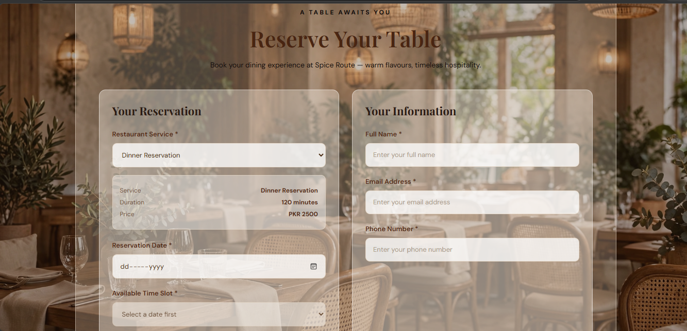
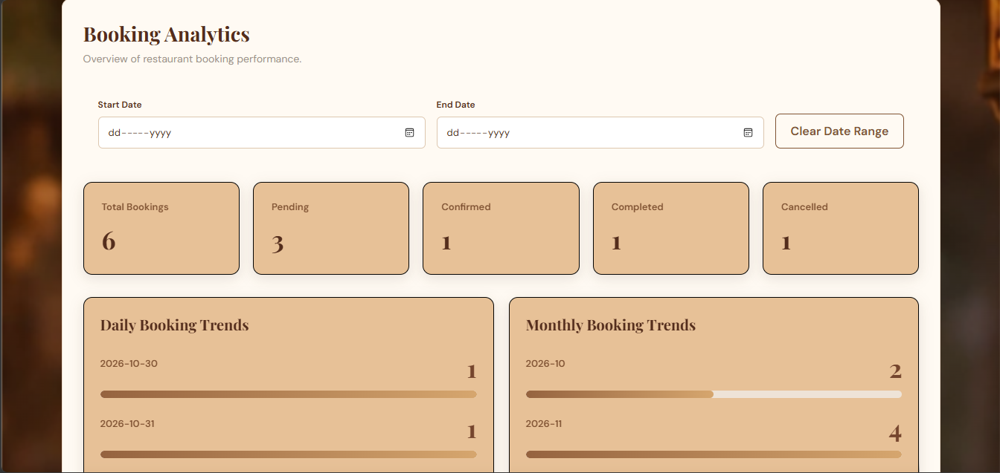

TASK 1
# Spice Route Restaurant Booking API

A REST API built with Node.js, Express.js, MongoDB, and Mongoose for managing restaurant services and customer bookings at Spice Route Restaurant.

This project is the foundation for an online booking platform designed for a family restaurant. It provides service listings, booking creation, input validation, and protection against duplicate reservations.

## Requirements

- Node.js
- npm
- MongoDB Atlas or a local MongoDB server
- Postman (optional, for manual API testing)

## Project Structure
text
Spice-Route-Booking/
├── README.md
└── server/
    ├── app.js
    ├── server.js
    ├── models/
    │   ├── Service.js
    │   └── Booking.js
    ├── routes/
    │   └── index.js
    ├── tests/
    │   └── api.test.js
    ├── .env
    ├── .gitignore
    ├── package.json
    └── package-lock.json


## Setup and Installation

### 1. Clone the repository
git clone YOUR_GITHUB_REPOSITORY_URL
cd Spice-Route-Booking
Replace `YOUR_GITHUB_REPOSITORY_URL` with your actual GitHub repository URL.

### 2. Install dependencies
Open a terminal in the `server` directory:
cd server
npm install

### 3. Configure environment variables

Create a file named `.env` inside the `server` directory:
PORT=5000
MONGODB_URI=your_mongodb_connection_string
Replace `your_mongodb_connection_string` with your MongoDB Atlas connection string or local MongoDB connection string.

**Security:** Never commit the `.env` file or expose your database credentials. The file is excluded through `.gitignore`.

### 4. Start the development server

From the `server` directory, run:
npm run dev
When the database connection succeeds, the terminal should display messages similar to:
MongoDB connected successfully.
Server running on port 5000

The API is available at:

`http://localhost:5000`

### 5. Verify the server

Open the following URL in your browser or API client:

`GET http://localhost:5000/`

The root endpoint returns the API status and whether the database is connected.

## API Endpoints

### 1. Get all services

**Endpoint:** `GET /services`

Returns the available restaurant services, including their names, durations, prices, and configured time slots.

**Example response:**
{
  "success": true,
  "count": 1,
  "services": [
    {
      "_id": "6adb1a9a65a837afb7bba721",
      "name": "Dinner Reservation",
      "duration": 120,
      "price": 2500,
      "availableSlots": [
        "18:00",
        "18:30",
        "19:00",
        "19:30",
        "20:00"
      ]
    }
  ]
}
```

The service ID above is an example from development data. Use the actual ID returned by your API when creating a booking.

### 2. Create a booking

**Endpoint:** `POST /bookings`

Creates a reservation for an existing service, date, and available time slot.

**Example request body:**

```json
{
  "service": "REPLACE_WITH_ACTUAL_SERVICE_ID",
  "date": "2026-11-01",
  "slot": "18:30",
  "customerName": "Ayesha Khan",
  "customerEmail": "ayesha@example.com",
  "customerPhone": "+923001234567"
}
```

Replace the service ID placeholder with a real service ID returned by `GET /services`.

**Successful response:** `201 Created`

The response contains a success indicator and the created booking.

### Validation and error responses

| HTTP status | Meaning |
|---|---|
| `201 Created` | Booking created successfully |
| `400 Bad Request` | Required fields are missing or input is invalid, or the requested slot is unavailable |
| `404 Not Found` | Requested API endpoint does not exist |
| `409 Conflict` | A booking already exists for the same service, date, and slot |
| `500 Internal Server Error` | Unexpected server error |

The API validates required booking fields, date format, service ID, customer email and phone, and whether the requested slot is configured for the selected service.

A unique compound index on service, date, and slot provides database-level protection against duplicate reservations.

## MongoDB Data Models

### Service

The Service model stores the restaurant services that customers can book.

Fields:

- `name`: service name; required.
- `duration`: service duration in minutes; must be positive.
- `price`: service price; must not be negative.
- `availableSlots`: list of configured booking times in 24-hour `HH:mm` format.
- `timestamps`: automatically records creation and update times.

**Example service:**

```json
{
  "name": "Dinner Reservation",
  "duration": 120,
  "price": 2500,
  "availableSlots": [
    "18:00",
    "18:30",
    "19:00",
    "19:30",
    "20:00"
  ]
}
```

### Booking

The Booking model stores customer reservation details.

Fields:

- `service`: reference to the selected Service document.
- `date`: reservation date.
- `slot`: requested booking time.
- `customerName`: customer's name.
- `customerEmail`: customer's email address, stored in lowercase.
- `customerPhone`: customer's contact number.
- `timestamps`: automatically records creation and update times.

A compound unique index on `{ service, date, slot }` prevents two bookings from using the same slot for the same service and date.

## Sample Data

The development database contains a sample service named **Dinner Reservation**, with a duration of 120 minutes, a price of 2500, and configured evening slots.

The price is stored as a numeric value. Its currency is not currently specified by the API.

Additional services, such as family dinner packages or birthday celebration reservations, can be added as the project develops.

## Automated Testing

The project uses **Jest** and **Supertest** to test the Express API.

From the `server` directory, run:

```bash
npm test
```

The current automated test suite covers:

1. `GET /services` returns the service list.
2. `POST /bookings` rejects requests with missing required fields.
3. `POST /bookings` rejects unavailable time slots.
4. `POST /bookings` returns `409 Conflict` for duplicate bookings.

**Latest test result:** All 4 tests passed in the local test run.

The automated tests mock the Mongoose models, so they test API behavior without creating or changing real MongoDB bookings. Manual testing against the connected database should also be performed to verify database integration.

## Design Decision and Trade-off

**Decision: Store services and bookings in separate MongoDB collections and reference services from bookings.**

Each booking stores a reference to its selected service instead of duplicating all service information inside the booking document.

**Reason:** Multiple customers can book the same type of service. Keeping service details separate makes them easier to manage and avoids repeating the same information in every booking.

**Trade-off:** Retrieving booking information together with service details may require an additional database query or Mongoose `populate()` operation.

A second important decision is the unique compound index on service, date, and slot. It prevents duplicate reservations at the database level, but the current model does not account for restaurant-wide seating capacity or multiple tables that could share a time slot.

## Current Limitations and Future Improvements

The current API is an initial backend foundation. It does not yet include:

- User authentication and authorization.
- Online payments or payment confirmation.
- Restaurant-wide table and seating capacity management.
- Advanced availability calculations based on existing bookings.
- Booking cancellation and rescheduling endpoints.
- A customer-facing frontend.

These features can be introduced in subsequent project tasks.

## Security Notes

- Keep MongoDB credentials in environment variables.
- Do not commit `.env` or other secret files.
- Validate all incoming booking data.
- Use the unique database index to protect against duplicate reservations.
- Review authentication, authorization, rate limiting, and other production security requirements before deploying the API publicly.

## Author and Project Purpose

This project was developed as Task 1 of the Spice Route Restaurant online booking platform internship project. The objective is to establish a maintainable Express API and MongoDB data model that future tasks can extend.

 

# TASK 2 – React Booking Flow with Available Slots

## Project Overview

Task 2 extends the Spice Route Restaurant Booking API developed in Task 1 by adding a React-based customer booking interface.

The frontend allows customers to view restaurant services, select a reservation date, check available time slots, enter their details, and submit a booking. After a successful reservation, customers are redirected to a confirmation page displaying their booking information.

The application uses React for the frontend and the existing Express.js and MongoDB backend for booking management.

## Technologies Used

**Frontend**
- React
- Vite
- React Router DOM
- Axios
- CSS

**Backend**
- Node.js
- Express.js
- MongoDB
- Mongoose

**Testing**
- Jest
- Supertest

## Task 2 Features

### 1. Restaurant Homepage

- Displays Spice Route Restaurant branding and introduction.
- Provides navigation to the Menu, About, Contact, and Booking pages.
- Includes links that allow customers to start the reservation process.

### 2. Menu Page

- Displays restaurant dishes organized into categories.
- Includes dish names, descriptions, prices, and images.
- Provides a reservation link so customers can proceed to booking.

### 3. Booking Page

Customers can:

1. View available restaurant services.
2. Select a service.
3. Choose a reservation date.
4. View available time slots for the selected date.
5. Select an available time.
6. Enter their name, email address, and phone number.
7. Submit their reservation.

The booking form validates required information before submitting the request to the backend.

### 4. Date-Based Slot Availability

The frontend requests available slots from the backend whenever the selected date or service changes.

**API Endpoint:**

`GET /services/:serviceId/availability?date=YYYY-MM-DD`

The backend checks existing bookings and returns the slots that are still available for the selected service and date.

This prevents the frontend from simply displaying a fixed list of slots without considering existing reservations.

### 5. Booking Confirmation

After a successful booking:

- The customer is redirected to the confirmation page.
- The page displays the customer's name, selected service, reservation date, time, and email address.
- A success message confirms that the booking was created.

## Frontend Project Structure
client/
├── public/
│   └── images/
├── src/
│   ├── assets/
│   ├── components/
│   │   └── Navbar.jsx
│   ├── pages/
│   │   ├── Home.jsx
│   │   ├── Menu.jsx
│   │   ├── About.jsx
│   │   ├── Contact.jsx
│   │   ├── Booking.jsx
│   │   └── Confirmation.jsx
│   ├── services/
│   │   └── api.js
│   ├── App.jsx
│   ├── App.css
│   ├── index.css
│   └── main.jsx
├── package.json
└── package-lock.json

## Setup and Running the Application

Task 1 backend setup and MongoDB environment configuration remain the same.

### 1. Start the Backend

Open a terminal in the project directory:
cd server
npm install
npm run dev

The backend runs at:

`http://localhost:5000`

Make sure the MongoDB connection is configured correctly in `server/.env`.

### 2. Start the React Frontend

Open a second terminal in the project directory:
cd client
npm install
npm run dev


Vite normally starts the frontend at:

`http://localhost:5173`

Open this address in your browser to use the application.

Keep both the backend and frontend terminals running while testing.

**Note:** The backend CORS configuration must allow the frontend development origin (`http://localhost:5173`) so that the React application can communicate with the API.

## Booking API Endpoints

Task 2 builds on the existing Task 1 endpoints.

| Method | Endpoint | Purpose |
|---|---|---|
| GET | `/services` | Retrieves restaurant services |
| GET | `/services/:serviceId/availability?date=YYYY-MM-DD` | Retrieves available slots for a selected service and date |
| POST | `/bookings` | Creates a customer reservation |

### Example Availability Request

```http
GET /services/6adb1a9a65a837afb7bba721/availability?date=2026-11-01
```

The response provides the available time slots for that service and date.

### Example Booking Request
{
  "service": "6adb1a9a65a837afb7bba721",
  "date": "2026-11-01",
  "slot": "18:30",
  "customerName": "Ayesha Khan",
  "customerEmail": "ayesha@example.com",
  "customerPhone": "+923001234567"
}
```

The service ID must be replaced with an actual ID returned by the services endpoint. The example date and slot are illustrative; availability must be checked before booking.

## Input Validation and Error Handling

The booking flow handles invalid or incomplete information to prevent unsuccessful submissions.

Examples include:

- Empty required fields are rejected with a clear validation message.
- Invalid email addresses are rejected.
- Invalid dates and service IDs are handled by the backend.
- Slots that are not configured or are already booked cannot be reserved.
- Duplicate reservations are rejected by the backend.
- API errors are handled so that the application can display an appropriate message instead of crashing.

The backend remains responsible for the final validation and booking creation. Frontend validation alone is not relied upon to prevent invalid reservations.

## Testing

### Automated Backend Tests

The backend uses Jest and Supertest.

Run the tests from the `server` directory:

```bash
npm test
```

The current test suite covers the main API operations, including:

1. Retrieving restaurant services.
2. Creating a valid booking.
3. Rejecting bookings with missing required fields.
4. Rejecting unavailable time slots.
5. Preventing duplicate bookings.
6. Retrieving available slots for a valid service and date.
7. Handling invalid dates.
8. Handling an unknown service.

**Latest recorded test result:** 8 backend tests passed in the local test run.

### Manual Frontend Test Plan

| Test scenario | Expected result |
|---|---|
| Open the homepage | Homepage loads successfully |
| Open the booking page | Booking form is displayed |
| Load restaurant services | Available services are displayed |
| Select a date | Available slots are requested for that date |
| Select an available slot and enter valid details | Booking is submitted successfully |
| Complete a successful booking | Confirmation page displays booking details |
| Submit the form with empty required fields | Clear validation messages appear |
| Select a date with a previously booked slot | That slot is not shown as available |
| Select another date | Availability refreshes for the new date |

The manual test plan covers both the successful customer journey and important failure cases.

## Design Decision and Trade-off

**Decision: Retrieve available time slots from the backend based on the selected service and reservation date.**

Instead of maintaining a fixed list of available slots in the React frontend, the application requests availability from the backend whenever the customer changes the selected service or date.

**Reason:**

A restaurant's available slots can change when customers make reservations. Retrieving availability from the backend allows the application to consider existing bookings and display more accurate availability.

**Trade-off:**

This approach requires additional API requests whenever the selected service or date changes. It also depends on the backend being available. However, it keeps the booking information centralized and reduces the risk of displaying already-booked slots.

The backend also validates the requested slot when a booking is submitted, providing another layer of protection against duplicate reservations.

## Task 2 Outcome

Task 2 extends the original backend API into a customer-facing restaurant booking application.

The completed workflow connects the React frontend with the Express and MongoDB backend, allowing customers to view services, check date-based availability, submit reservations, and view booking confirmations.

The project provides a foundation for future improvements such as table capacity management, booking cancellation, customer authentication, and online payments.

## Task 3: JWT Login for Customers and Staff

### Overview

Task 3 extends the Spice Route Restaurant online booking platform with secure authentication for customers and restaurant staff.

The authentication system allows customers to create accounts and log in, while staff members use a separately created staff account. Role-based authorization protects staff-only API endpoints and prevents customers from accessing staff booking information.

The implementation builds on the existing Express.js, MongoDB, and React application.

### Features Implemented

- **Customer registration:** Customers can register using their name, email address, and password.
- **Customer login:** Registered customers can log in using their email and password.
- **Staff login:** Restaurant staff can log in using an account created through a protected setup script.
- **Password security:** Passwords are hashed using bcrypt before being stored in MongoDB.
- **JWT authentication:** Successful registration and login return a JSON Web Token.
- **Protected profile endpoint:** Authenticated users can retrieve their profile.
- **Role-based authorization:** Only staff accounts can access the staff bookings endpoint.
- **Frontend authentication:** React login and registration pages connect to the backend authentication API.
- **Session management:** Authentication information is stored in browser session storage, and users can log out.
- **Input validation:** Missing fields, invalid email addresses, short passwords, duplicate accounts, and incorrect login credentials are handled with clear error messages.

### Technology Used

| Technology | Purpose |
|---|---|
| React | Login and registration interface |
| Node.js | Backend runtime |
| Express.js | Authentication API |
| MongoDB Atlas | User account storage |
| Mongoose | Database models |
| bcryptjs | Password hashing |
| jsonwebtoken | JWT creation and verification |
| Axios | Frontend API communication |
| Jest | Automated backend testing |
| Supertest | HTTP endpoint testing |

### User Roles

The system supports two roles:

| Role | Permissions |
|---|---|
| Customer | Register, log in, and access their authenticated profile |
| Staff | Log in, access their authenticated profile, and retrieve restaurant bookings |

Public registration always creates a customer account. Users cannot assign themselves the staff role through the registration API.

Staff accounts are created separately using the backend setup script.

### API Endpoints

Base URL: `http://localhost:5000`

| Method | Endpoint | Access | Description |
|---|---|---|---|
| POST | `/auth/register` | Public | Register a customer |
| POST | `/auth/login` | Public | Log in a customer or staff member |
| GET | `/auth/me` | Authenticated | Retrieve the logged-in user's profile |
| GET | `/staff/bookings` | Staff only | Retrieve restaurant bookings |

Protected endpoints require a JWT in the Authorization header:

```http
Authorization: Bearer YOUR_JWT_TOKEN
```

### Environment Configuration

Create a `.env` file inside the `server` directory.

Add the following configuration with your own values:

```env
PORT=5000
MONGODB_URI=your_mongodb_connection_string
JWT_SECRET=your_long_random_secret
CLIENT_URL=http://localhost:5173

STAFF_NAME=Restaurant Staff
STAFF_EMAIL=staff@example.com
STAFF_PASSWORD=your_secure_staff_password
```

**Important:** Never commit the `.env` file or share your JWT secret, database credentials, or staff password publicly.

### How to Run the Project

#### 1. Start the Backend

Open a terminal:

```powershell
cd server
npm install
npm run dev
```

The backend runs at:

`http://localhost:5000`

#### 2. Create the Staff Account

Configure the staff details in `server/.env`, then run:

```powershell
npm run create:staff
```

The script creates a staff account with the `staff` role. It prevents creating another account with the same email address.

#### 3. Start the Frontend

Open a second terminal from the project root:

```powershell
cd client
npm install
npm run dev
```

Open the Vite URL:

`http://localhost:5173`

Use the Register page to create a customer account, or the Login page to sign in as a customer or staff member.

### Authentication Workflow

1. A customer submits the registration form.
2. The backend validates the input and checks whether the email is already registered.
3. The password is hashed using bcrypt before the account is saved.
4. The backend returns a JWT after successful registration or login.
5. The frontend stores the token and user information in session storage.
6. Axios attaches the token to authenticated API requests.
7. The authentication middleware verifies the JWT and retrieves the user.
8. The authorization middleware checks the user's role before allowing access to staff-only endpoints.
9. Users can log out to clear their current browser session.

### Security and Validation

- Passwords are never stored as plain text.
- bcrypt uses a cost factor of 12 for password hashing.
- Passwords must contain at least eight characters.
- Email addresses are normalized before account creation and login.
- Duplicate email registration is rejected.
- Invalid login credentials return an unauthorized response.
- Missing or invalid JWTs are rejected.
- Customers attempting to access staff-only routes receive a forbidden response.
- Staff credentials are configured separately from public registration.
- JWTs are configured with a seven-day expiration.

### Automated Testing

Backend tests are implemented using Jest and Supertest.

Run the complete test suite from the `server` directory:

```powershell
npm test -- --runInBand
```

**Latest test results:**

| Test suite | Tests passed |
|---|---:|
| Booking API tests | 8 |
| Authentication and authorization tests | 13 |
| **Total** | **21/21** |

Authentication tests cover:

- Successful customer registration.
- Missing registration fields.
- Password length validation.
- Duplicate email registration.
- Successful customer login.
- Successful staff login.
- Incorrect password.
- Unknown email address.
- Access to the authenticated profile.
- Missing authentication token.
- Customer access denied to staff-only routes.
- Staff access granted to staff-only routes.

### Manual Testing Checklist

| Test | Expected result |
|---|---|
| Register with valid details | Customer account created |
| Register with an existing email | Clear duplicate-account error |
| Register with missing fields | Validation error |
| Register with a short password | Password validation error |
| Login with correct credentials | Successful login and JWT |
| Login with incorrect credentials | Unauthorized response |
| Access `/auth/me` without a token | HTTP 401 |
| Access `/staff/bookings` without a token | HTTP 401 |
| Access `/staff/bookings` as a customer | HTTP 403 |
| Access `/staff/bookings` as staff | HTTP 200 |
| Log out from the frontend | Session authentication cleared |

### Design Decision and Trade-offs

**Decision: Use JWT authentication with browser session storage.**

JWT was selected because it provides a stateless way to authenticate API requests and works well with the React frontend and Express backend.

The frontend stores the JWT in `sessionStorage`, which keeps the login active across page refreshes within the current browser tab session and clears it when that session ends.

**Trade-off:** Session storage is accessible to JavaScript, so a successful cross-site scripting (XSS) attack could expose the token. For a production deployment, an alternative would be a secure, HttpOnly cookie with appropriate SameSite and CSRF protections.

A separate staff account creation script was also chosen so public registration cannot grant staff privileges.

### Task 3 Scope

This task implements customer and staff authentication, user roles, and staff-only API authorization.

The staff dashboard and additional staff management features are reserved for a later development task.

### Result

Task 3 successfully adds JWT-based authentication to the Spice Route Restaurant booking platform. Customers can register and log in, staff can use separately provisioned accounts, and protected API endpoints enforce role-based access.

The backend currently passes **21 automated tests across two test suites**.

## Task 4: Staff Dashboard and Booking Management

### Overview
A protected staff dashboard was developed to help restaurant staff manage customer reservations efficiently. Staff members can view bookings, monitor booking statistics, search for specific reservations, filter bookings, and update their statuses.

### Features
- **Staff-only access:** The dashboard is accessible only to authenticated users with the staff role.
- **Booking overview:** Displays booking statistics, including total bookings and booking statuses.
- **Search:** Search bookings by customer name, email, phone number, or service name.
- **Date filter:** View bookings for a selected date.
- **Status filter:** Filter bookings by pending, confirmed, completed, or cancelled status.
- **Status management:** Staff can update a booking's status directly from the dashboard.
- **User feedback:** Displays loading indicators, error messages, success messages, and an empty state when no bookings are found.
- **Responsive design:** The dashboard layout adapts to different screen sizes.

### Booking Statuses
Each booking can have one of the following statuses:
- `pending` – The booking is awaiting confirmation.
- `confirmed` – The booking has been confirmed by staff.
- `completed` – The reservation has been completed.
- `cancelled` – The reservation has been cancelled.

### API Endpoints

All staff booking management endpoints require a valid JWT token and staff authorization.

| Method | Endpoint | Description |
|---|---|---|
| GET | `/staff/bookings` | Retrieve all bookings |
| GET | `/staff/bookings?date=YYYY-MM-DD` | Filter bookings by date |
| GET | `/staff/bookings?status=pending` | Filter bookings by status |
| PATCH | `/staff/bookings/:bookingId/status` | Update a booking's status |

The status update endpoint accepts a JSON request body:

```json
{
  "status": "confirmed"
}
```

Invalid booking IDs, unsupported statuses, missing bookings, and unauthorized requests are handled with appropriate error responses.

### Running the Application

**1. Start the backend**

Open a terminal in the project root and run:

```bash
cd server
npm install
npm run dev
```

**2. Start the frontend**

Open a second terminal and run:

```bash
cd client
npm install
npm run dev
```

**3. Access the dashboard**

1. Open the frontend URL provided by Vite, usually `http://localhost:5173`.
2. Log in using an account with the staff role.
3. Open the Staff Dashboard from the navigation bar.
4. View, search, filter, and update customer bookings.

A staff account can be created using the backend staff creation script:

```bash
cd server
npm run create:staff
```

Configure the required environment variables before running the application. Do not commit `.env` files or share account credentials.

### Testing

Backend tests can be run with:

```bash
cd server
npm test -- --runInBand
```

The staff booking management tests cover:
- Retrieving bookings.
- Filtering bookings by date and status.
- Rejecting invalid filters.
- Updating booking statuses.
- Handling invalid booking IDs and missing bookings.
- Rejecting unauthorized requests.

The authentication tests also verify that customers cannot access staff-only booking management routes.

### Design Decision and Trade-off

Instead of permanently deleting cancelled bookings, the application updates their status to `cancelled`. This preserves booking history and allows staff to keep track of previous reservations. The trade-off is that cancelled bookings remain stored in the database, so staff may need to use the status filter to focus on active reservations.

### Outcome

Task 4 completes the staff booking management workflow by providing a secure dashboard for viewing, searching, filtering, and updating restaurant reservations.

## Task 5: Reminders and Booking Analytics

### Overview

Task 5 extends the Spice Route Restaurant Booking System with automated booking reminders and booking analytics. These features help restaurant staff reduce missed reservations, monitor booking activity, and understand customer booking trends.

The implementation uses the existing MERN stack and builds on the previous booking system and staff dashboard.

### Features Implemented

#### 1. Automated Booking Reminders

- Integrated **Nodemailer** with Gmail SMTP to send booking reminder emails.
- Sends reminders approximately 24 hours before confirmed reservations.
- Uses **Node-Cron** to check for due reminders every 15 minutes.
- Checks for due reminders when the server starts, allowing eligible reminders to be processed after downtime.
- Stores `reminderSent` and `reminderSentAt` in each booking to prevent normal repeated reminders.
- Sends reminders only for confirmed bookings that have not already received one.
- Does not mark a reminder as sent if email delivery fails.

#### 2. Booking Analytics

Added a protected staff analytics API and integrated analytics into the existing staff dashboard.

The dashboard displays:

- Total number of bookings.
- Pending, confirmed, completed, and cancelled booking counts.
- Daily booking trends.
- Monthly booking trends.
- Popular restaurant services.
- Date-range filtering for analytics.

Analytics are calculated from actual booking records stored in MongoDB rather than hardcoded values.

#### 3. Input Validation and Error Handling

- Validates date formats using `YYYY-MM-DD`.
- Rejects invalid calendar dates.
- Prevents a start date from being later than the end date.
- Returns clear error responses for invalid analytics filters.
- Handles empty booking results by displaying zero counts and empty trend data.
- Restricts analytics access to authenticated staff members.
- Handles database and email delivery errors without crashing the reminder scheduler.

### Technologies Used

- React.js
- Node.js
- Express.js
- MongoDB and Mongoose
- Nodemailer
- Gmail SMTP
- Node-Cron
- Luxon
- Jest and Supertest

### Environment Configuration

Add the following variables to `server/.env`:

```env
GMAIL_USER=your-gmail-address
GMAIL_APP_PASSWORD=your-gmail-app-password
RESTAURANT_NAME=Spice Route Restaurant
RESTAURANT_TIMEZONE=Asia/Karachi
```

**Important:** Use a Gmail App Password rather than your normal Gmail password. Keep the `.env` file private and never commit it to GitHub.

### Running the Project

**1. Start the backend**

```bash
cd server
npm install
npm run dev
```

The backend connects to MongoDB, verifies the Gmail email service, and starts the reminder scheduler.

**2. Start the frontend**

Open another terminal:

```bash
cd client
npm install
npm run dev
```

Open the local frontend URL shown in the terminal, usually:

```text
http://localhost:5173
```

Log in using a staff account to access the dashboard and analytics.

### API Endpoint

| Method | Endpoint | Description |
|---|---|---|
| GET | `/staff/analytics` | Retrieves booking analytics |
| GET | `/staff/analytics?startDate=YYYY-MM-DD&endDate=YYYY-MM-DD` | Retrieves analytics for a date range |

The analytics endpoint requires staff authentication through a JWT token.

### How to Check the Features

**Booking reminders**

1. Configure Gmail SMTP credentials in `server/.env`.
2. Start the backend and confirm that the Gmail connection succeeds.
3. Create a reservation using a controlled test email address.
4. Confirm the reservation through the staff dashboard.
5. Check that the reservation is eligible for a reminder.
6. The scheduler checks every 15 minutes and processes reminders once their 24-hour reminder time has arrived.
7. Check the recipient inbox and the backend terminal for the delivery result.

For a quick test, use a confirmed reservation less than 24 hours away but still in the future. The scheduler processes overdue reminders for eligible future reservations.

**Booking analytics**

1. Log in using a staff account.
2. Open the staff dashboard.
3. View the analytics summary cards, daily and monthly trends, and popular services.
4. Apply a start and end date to filter analytics.
5. Try an invalid date range and verify that a clear validation message is displayed.
6. Check the dashboard with no matching bookings to verify that empty results are handled correctly.

### Testing

Backend tests are written using Jest and Supertest.

Run the complete backend test suite:

```bash
cd server
npm test -- --runInBand
```

**Latest test results:**

- Test Suites: 5 passed
- Tests: 44 passed
- Snapshots: 0
- All backend test suites passed successfully.

The tests cover booking APIs, authentication, staff booking management, reminder processing, and booking analytics.

Reminder tests include successful reminder processing, reminders becoming due, bookings more than 24 hours away, past bookings, already-reminded bookings, email delivery failures, and database errors.

Analytics tests include successful results, date-range filtering, invalid date formats, invalid calendar dates, incorrect date ranges, empty results, and unauthorized access.

### Sample Restaurant Data

The system uses realistic restaurant booking information, including:

- Restaurant: Spice Route Restaurant
- Service: Dinner Reservation
- Example reservation slots: 18:00, 18:30, 19:00, 19:30, and 20:00
- Example customer names: Ayesha Khan and Ali Ahmed
- Example booking statuses: Pending, Confirmed, Completed, and Cancelled

Analytics are generated from the bookings stored in the database. For testing, use sample reservations with realistic dates, service names, and controlled test email addresses.

### Design Decision and Trade-off

**Decision: Store reminder information directly in the Booking model.**

Instead of creating a separate reminder collection, the system stores `reminderSent` and `reminderSentAt` with each booking.

**Reason:** Each booking currently requires one 24-hour reminder. Keeping reminder information with the booking makes the implementation simpler and allows the scheduler to identify reminders that still need processing without maintaining another collection.

**Trade-off:** This approach is suitable for the current restaurant booking system, but it provides limited reminder history and is less suitable for multiple reminder types or large-scale distributed processing. A production system with multiple server instances could benefit from a dedicated reminder queue or transactional outbox to improve delivery reliability.

The scheduler also uses an in-process overlap guard. This prevents overlapping checks within one server process, but does not coordinate multiple server instances.

### Task 5 Outcome

Task 5 successfully adds automated email reminders and booking analytics to the Spice Route Restaurant Booking System. Staff can monitor reservation activity through the dashboard, while customers can receive reminders before confirmed reservations. The implementation includes validation, error handling, automated scheduling, and backend tests to improve reliability and maintainability.

## Task 6: Deployment, Documentation & Handover

### Live Deployment

The Spice Route Restaurant Booking application is deployed on Vercel.

- **Live Website:** https://spice-route-booking-sdfp.vercel.app/
- **Backend API:** https://spice-route-booking.vercel.app/
- **Source Code:** https://github.com/Hina1munir2/Spice-Route-Booking

### Deployment Architecture

The application uses two separate Vercel projects connected to the same GitHub repository:

- Frontend: React and Vite (`client` directory).
- Backend: Node.js and Express (`server` directory).
- Database: MongoDB Atlas.
- Frontend-backend communication: REST API with configured CORS.
- Environment variables are configured through Vercel project settings.

### Completed Features

- Customer registration and login using JWT authentication.
- Restaurant services and availability checking.
- Online booking creation and confirmation.
- Staff authentication and protected dashboard.
- Booking management and status updates.
- Booking reminder email service.
- Booking analytics and reporting.
- Responsive frontend pages.

### Testing and Verification

- Backend automated tests: 5 test suites, 44 tests passed.
- Frontend production build completed successfully.
- Live backend API and MongoDB connection verified.
- Live customer booking flow tested.
- Customer and staff authentication tested.
- Staff dashboard and analytics tested.

### Deployment Decisions and Trade-offs

- Frontend and backend are deployed separately to support independent deployment and configuration.
- MongoDB connections are cached to support serverless execution.
- The local reminder scheduler runs every 15 minutes.
- Vercel Cron is configured for the deployed reminder endpoint. On the Hobby plan, scheduled execution is limited to once per day, so reminders may not be delivered exactly 24 hours before a reservation.
- Sensitive configuration values are stored as environment variables rather than committed to GitHub.

### Handover and Future Improvements

The main application features have been implemented and deployed. Future improvements could include more frequent production reminder scheduling, image optimization, and more detailed analytics reporting.

## Application Screenshots

### Home Page


### Menu


### Customer Booking


### Booking Confirmation


### Customer Login


### Customer Registration


### Staff Dashboard


### Booking Analytics
